<a href="https://github.com/masterkain#gh-light-mode-only">
<picture>
  <source media="(max-width: 1079px)" srcset="assets/hero-light-mobile.svg">
  
</picture>
</a>

<a href="https://github.com/masterkain#gh-dark-mode-only">
<picture>
  <source media="(max-width: 1079px)" srcset="assets/hero-dark-mobile.svg">
  
</picture>
</a>

  <a href="https://github.com/icoretech"><b>iCoreTech on GitHub</b></a> &nbsp;·&nbsp;
  <a href="mailto:masterkain@gmail.com"><b>Email</b></a> &nbsp;·&nbsp;
  <a href="https://x.com/masterkain"><b>X</b></a> &nbsp;·&nbsp;
  <a href="https://github.com/masterkain.gpg"><b>PGP</b></a>

 

## 👋 &nbsp;About

I'm **Kain** (Claudio Poli), founder of **[iCoreTech, Inc.](https://github.com/icoretech)**, a small studio building media platforms, infrastructure tools and carefully shipped software since 2009.

I work across Ruby, TypeScript, Go, Swift, Elixir, Python, Objective-C and Terraform, on Kubernetes and GitOps, and I still write the code.

Open to conversations about senior engineering and technical leadership work. Email is the fastest way to reach me.

 

## 🔑 &nbsp;Identity

My **PGP key**: [`915D C480 9352 5AB2`](https://github.com/masterkain.gpg) `(master key)`

- `Claudio Poli <masterkain@gmail.com>`
- Fingerprint: `65A2 21AD 2A68 4489 A8D0 DA8E 915D C480 9352 5AB2`

 

## 🪐 &nbsp;In orbit

Eight open-source projects from [iCoreTech](https://github.com/icoretech), each with a year of commits. Tap a card to open the repository.

<a href="https://github.com/icoretech/codex-pooler#gh-light-mode-only">
<picture>
  <source media="(max-width: 1079px)" srcset="assets/projects/codex-pooler-light-mobile.svg">
  
</picture>
</a>

<a href="https://github.com/icoretech/codex-pooler#gh-dark-mode-only">
<picture>
  <source media="(max-width: 1079px)" srcset="assets/projects/codex-pooler-dark-mobile.svg">
  
</picture>
</a>

<a href="https://github.com/icoretech/airbroke#gh-light-mode-only">
<picture>
  <source media="(max-width: 1079px)" srcset="assets/projects/airbroke-light-mobile.svg">
  
</picture>
</a>

<a href="https://github.com/icoretech/airbroke#gh-dark-mode-only">
<picture>
  <source media="(max-width: 1079px)" srcset="assets/projects/airbroke-dark-mobile.svg">
  
</picture>
</a>

<a href="https://github.com/icoretech/helm#gh-light-mode-only">
<picture>
  <source media="(max-width: 1079px)" srcset="assets/projects/helm-light-mobile.svg">
  
</picture>
</a>

<a href="https://github.com/icoretech/helm#gh-dark-mode-only">
<picture>
  <source media="(max-width: 1079px)" srcset="assets/projects/helm-dark-mobile.svg">
  
</picture>
</a>

<a href="https://github.com/icoretech/wootty#gh-light-mode-only">
<picture>
  <source media="(max-width: 1079px)" srcset="assets/projects/wootty-light-mobile.svg">
  
</picture>
</a>

<a href="https://github.com/icoretech/wootty#gh-dark-mode-only">
<picture>
  <source media="(max-width: 1079px)" srcset="assets/projects/wootty-dark-mobile.svg">
  
</picture>
</a>

<a href="https://github.com/icoretech/warden-mcp#gh-light-mode-only">
<picture>
  <source media="(max-width: 1079px)" srcset="assets/projects/warden-mcp-light-mobile.svg">
  
</picture>
</a>

<a href="https://github.com/icoretech/warden-mcp#gh-dark-mode-only">
<picture>
  <source media="(max-width: 1079px)" srcset="assets/projects/warden-mcp-dark-mobile.svg">
  
</picture>
</a>

<a href="https://github.com/icoretech/spotify-client#gh-light-mode-only">
<picture>
  <source media="(max-width: 1079px)" srcset="assets/projects/spotify-client-light-mobile.svg">
  
</picture>
</a>

<a href="https://github.com/icoretech/spotify-client#gh-dark-mode-only">
<picture>
  <source media="(max-width: 1079px)" srcset="assets/projects/spotify-client-dark-mobile.svg">
  
</picture>
</a>

<a href="https://github.com/icoretech/mattermost-timeline#gh-light-mode-only">
<picture>
  <source media="(max-width: 1079px)" srcset="assets/projects/mattermost-timeline-light-mobile.svg">
  
</picture>
</a>

<a href="https://github.com/icoretech/mattermost-timeline#gh-dark-mode-only">
<picture>
  <source media="(max-width: 1079px)" srcset="assets/projects/mattermost-timeline-dark-mobile.svg">
  
</picture>
</a>

<a href="https://github.com/icoretech/mattermost-voice-messages#gh-light-mode-only">
<picture>
  <source media="(max-width: 1079px)" srcset="assets/projects/mattermost-voice-messages-light-mobile.svg">
  
</picture>
</a>

<a href="https://github.com/icoretech/mattermost-voice-messages#gh-dark-mode-only">
<picture>
  <source media="(max-width: 1079px)" srcset="assets/projects/mattermost-voice-messages-dark-mobile.svg">
  
</picture>
</a>

<b>Try them live&nbsp;→</b>&nbsp; <a href="https://codex-pooler.com">codex-pooler.com</a> &nbsp;·&nbsp; <a href="https://icoretech.github.io/helm">icoretech.github.io/helm</a>

<b>All 30 public iCoreTech repositories</b>

 

| Project | What it is | Stars | Commits | Releases |
| :--- | :--- | ---: | ---: | ---: |
| [codex-pooler](https://github.com/icoretech/codex-pooler) 🪐 | The self-hosted Codex gateway for teams, agents and you. | 236 | 4,684 | 167 |
| [airbroke](https://github.com/icoretech/airbroke) 🪐 | Open-source, Sentry-compatible error catcher. Self-hosted, Postgres-backed. | 220 | 2,685 | 136 |
| [helm](https://github.com/icoretech/helm) 🪐 | The iCoreTech Helm charts: opinionated Kubernetes deployments. | 18 | 1,119 | 747 |
| [warden-mcp](https://github.com/icoretech/warden-mcp) 🪐 | Vaultwarden / Bitwarden MCP server for credential-aware AI agents. | 26 | 431 | 86 |
| [wootty](https://github.com/icoretech/wootty) 🪐 | A browser terminal for shells, coding agents and long-running work. | 31 | 512 | 26 |
| [mattermost-timeline](https://github.com/icoretech/mattermost-timeline) 🪐 | Webhook-powered event timeline for Mattermost: deploys, alerts, incidents. | 11 | 338 | 27 |
| [codex-action](https://github.com/icoretech/codex-action) | Run OpenAI Codex CLI non-interactively in GitHub Actions workflows. | 13 | 167 | 68 |
| [spotify-client](https://github.com/icoretech/spotify-client) 🪐 | A Ruby client for the Spotify Web API. Small, complete, tested. | 79 | 72 | 3 |
| [mattermost-voice-messages](https://github.com/icoretech/mattermost-voice-messages) 🪐 | WhatsApp-style voice messages for Mattermost channels and threads. | 10 | 101 | 14 |
| [omniauth-spotify](https://github.com/icoretech/omniauth-spotify) | OmniAuth strategy for Spotify. Drop-in OAuth 2.0 for Rails. | 65 | 48 | 0 |
| [airbroke-site](https://github.com/icoretech/airbroke-site) | The Airbroke marketing and documentation site. | 0 | 832 | 0 |
| [autopathcomment](https://github.com/icoretech/autopathcomment) | Automatically comment on PRs that touch flagged paths. | 1 | 218 | 5 |
| [codex-docker](https://github.com/icoretech/codex-docker) | OpenAI Codex CLI Docker images for repeatable agent automation. | 10 | 107 | 0 |
| [rack-strip-cookies](https://github.com/icoretech/rack-strip-cookies) | Strip cookies from requests before they reach your Rack app. | 7 | 89 | 1 |
| [openai-json-pricing](https://github.com/icoretech/openai-json-pricing) | OpenAI model pricing as machine-readable JSON. | 1 | 74 | 0 |
| [pgbouncer-docker](https://github.com/icoretech/pgbouncer-docker) | 🐳 Multi-arch PgBouncer Docker image built from official upstream releases (amd64/arm64) | 3 | 38 | 0 |
| [omniauth-dropbox2](https://github.com/icoretech/omniauth-dropbox2) | 🔌 OmniAuth strategy for Dropbox OAuth2 authentication | 2 | 32 | 0 |
| [omniauth-twitchtv2](https://github.com/icoretech/omniauth-twitchtv2) | 🔌 OmniAuth strategy for Twitch OAuth2 authentication | 0 | 52 | 0 |
| [bitwarden-cli-docker](https://github.com/icoretech/bitwarden-cli-docker) | 🐳 Bitwarden CLI Docker image built from official upstream releases | 0 | 34 | 0 |
| [omniauth-lastfm](https://github.com/icoretech/omniauth-lastfm) | 🔌 OmniAuth strategy for Last.fm OAuth authentication | 0 | 34 | 0 |
| [activerecord-s3-bucket-name-validator](https://github.com/icoretech/activerecord-s3-bucket-name-validator) | 💎 ActiveModel validator for Amazon S3 bucket names (general, directory, S3 Tables, S3 Vectors) with i18n | 0 | 14 | 2 |
| [omniauth-microsoft-identity2](https://github.com/icoretech/omniauth-microsoft-identity2) | 🔌 OmniAuth strategy for Microsoft Identity (Entra ID) OAuth2/OpenID Connect authentication | 0 | 16 | 0 |
| [omniauth-apple2](https://github.com/icoretech/omniauth-apple2) | 🔌 OmniAuth OAuth2 strategy for Sign in with Apple | 0 | 15 | 0 |
| [omniauth-box2](https://github.com/icoretech/omniauth-box2) | 🔌 OmniAuth strategy for Box OAuth2 authentication | 0 | 15 | 0 |
| [omniauth-google2](https://github.com/icoretech/omniauth-google2) | 🔌 OmniAuth strategy for Google OAuth2/OpenID Connect authentication | 0 | 15 | 0 |
| [omniauth-facebook2](https://github.com/icoretech/omniauth-facebook2) | 🔌 OmniAuth strategy for Facebook OAuth2 authentication | 0 | 13 | 0 |
| [omniauth-soundcloud2](https://github.com/icoretech/omniauth-soundcloud2) | 🔌 OmniAuth strategy for SoundCloud OAuth2 authentication | 0 | 10 | 0 |
| [eeevp](https://github.com/icoretech/eeevp) | 🔐 Zero-trust streaming concept with browser-side video encryption, built for Synteq Hackathon 2026. | 0 | 8 | 0 |
| [motion-glass-catalog](https://github.com/icoretech/motion-glass-catalog) | Machine-readable model + pricing catalog for Motion Glass | 0 | 4 | 0 |
| [omniauth-slack2](https://github.com/icoretech/omniauth-slack2) | 🔌 OmniAuth strategy for Slack OpenID Connect authentication | 0 | 4 | 0 |

Commits count every author on the default branch. Releases are published GitHub releases, prereleases included. Updated 2026-11-08.

 

<a href="https://github.com/icoretech#gh-light-mode-only">
<picture>
  <source media="(max-width: 1079px)" srcset="assets/footer-light-mobile.svg">
  
</picture>
</a>

<a href="https://github.com/icoretech#gh-dark-mode-only">
<picture>
  <source media="(max-width: 1079px)" srcset="assets/footer-dark-mobile.svg">
  
</picture>
</a>
